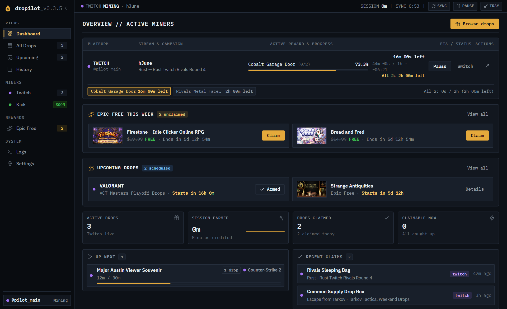

# Dropilot

**Dropilot** is a lightweight, privacy-focused Windows desktop application that automatically tracks and farms **Twitch Drops**, tracks **Upcoming Drops**, and monitors **Epic Games Weekly Free Games** — with zero browser tabs and a tiny system tray memory footprint (~12 MB RAM in tray).

> **Disclaimer:** Using automation tools may violate Twitch Terms of Service. You are solely responsible for your own accounts. Dropilot is an independent utility and is not affiliated with, sponsored by, or endorsed by Twitch Interactive, Inc. or Epic Games, Inc.

---

## Download

Go to **[Releases](https://github.com/theflash1211/dropilot-releases/releases/latest)** and pick one:

- **`Dropilot_*_x64-setup.exe` (Recommended):** Per-user Windows installer (`%LOCALAPPDATA%`, no admin UAC required) with desktop/Start Menu shortcuts and **automatic Minisign-verified in-app updates**.
- **`Dropilot-*-win64-portable.zip`:** Plain portable ZIP — unzip and run `Dropilot.exe` with zero installation.
- **`SHA256SUMS.txt` & VirusTotal:** Every release includes SHA-256 checksums and automatic VirusTotal scan links in the release notes.

### Windows Requirements
- Windows 10 (22H2+) or Windows 11 (64-bit)
- Microsoft Edge WebView2 Runtime (already pre-installed on modern Windows 10/11)

---

## Features

- **Zero-Video Twitch Drops Mining:** Automatically discovers active drop campaigns, selects live drops-enabled streams, sends stream-less watch heartbeats (0 Mbps video), and auto-claims earned rewards.
- **Upcoming Drops Scheduler:** Dedicated **Upcoming** view and Dashboard preview showing scheduled Twitch drops and next-week Epic freebies with live countdowns, 1-click **Auto-farm when live**, and Windows "Now Live" alerts.
- **Epic Games Weekly Free Tracker:** Tracks live and upcoming Epic Games Store weekly free titles with countdown timers, desktop alerts, and 1-click assisted checkout.
- **Tray-First Tiny Footprint:** Minimizing or closing to the system tray destroys the UI WebView2 window while keeping the lightweight Rust core running quietly in the background (~12 MB RAM).
- **Priority Queue & Game Watchlist:** Order games and campaigns by priority, filter ending-soon drops, auto-clear completed campaigns while keeping game watchlists, and auto-mine watched games the moment a campaign goes live.
- **Lifetime History & Analytics:** 14-day watch activity chart, streaks, top games, and CSV/JSON export.
- **Signed Auto-Updates & Remote Config:** Cryptographically verified in-app updates (`Minisign`) and live remote GQL hash updates so Twitch API changes are fixed quickly.
- **Coming Soon:** Kick Drops automation and Kick watch-time reward cases.

---

## Security & Privacy

- **Official Login Only:** No password fields inside Dropilot. Sign-in happens directly on official Twitch/Epic pages inside Dropilot's isolated WebView2 window.
- **Windows Credential Manager:** Session tokens are encrypted via Windows DPAPI and stored strictly in Windows Credential Manager — never in plain text or logs.
- **Zero Browser Profile Access:** Dropilot never reads Chrome, Edge, Firefox, Brave, or Opera profiles or cookies.
- **Strict Outbound Allowlist:** Every network call is validated against an allowlist of official domains.
- **Zero Telemetry & Zero Packers:** No analytics, no tracking, no UPX/packers, standard `asInvoker` privileges.

Read the full details in [PRIVACY.md](PRIVACY.md) and [ENDPOINTS.md](ENDPOINTS.md).

---

## Note on Windows SmartScreen & Smart App Control

- **SmartScreen:** Because Dropilot is an independent utility without a paid EV Authenticode certificate yet, Windows SmartScreen may show *"Windows protected your PC — Unknown publisher"* on new releases. Verify the file hash against `SHA256SUMS.txt` and check the VirusTotal report linked in the release notes, then click **More info → Run anyway**.
- **Windows 11 Smart App Control:** If it is turned on, it blocks unsigned apps completely and there is no "Run anyway" button. Dropilot is not code-signed yet. To install, turn it off in **Windows Security > App & browser control > Smart App Control settings**. Only do this if you accept the tradeoff, and verify the SHA-256 checksum first.
